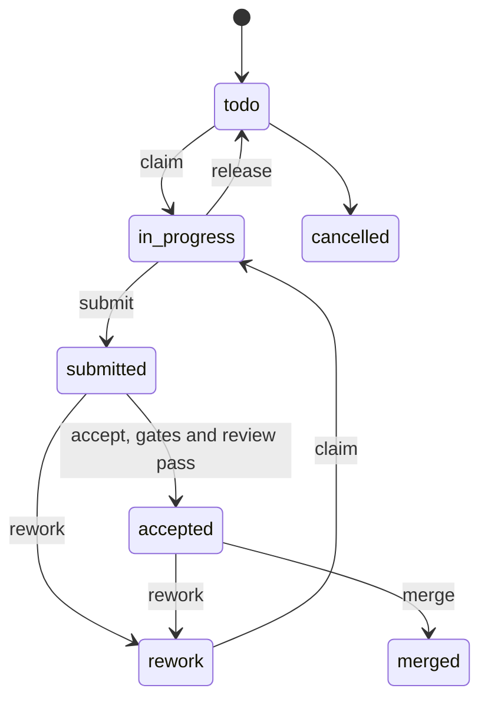

<div align="center">
  <h1>Tower Crane</h1>
  <p><strong>Hand agents an issue or a whole project. Software keeps the plan, the gates and the merge.</strong></p>
  <p>
    <a href="https://github.com/agent-sh/tower-crane/actions/workflows/ci.yml"></a>
    <a href="https://www.npmjs.com/package/@agent-sh/tower-crane"></a>
    <a href="LICENSE"></a>
  </p>
</div>

> Running open models for your company? [**Tiyuvta**](https://tiyuvta.ai/services/) helps with model choice, deployment and optimization, and fine-tuning on your hardware or cloud account.

Tower Crane is a CLI and an agent plugin for delegating software work to coding agents. An orchestrator agent splits the work into tasks, spawns a worker per task in its own worktree and sandbox, gets each change reviewed by an agent that did not write it, and merges it once software gates pass. The plan and its progress live in plain JSON files that only the CLI writes. It is for people who want agents to carry a project end to end: you watch instead of steering, and answer the few questions only you can answer. It is part of the [agentsys](https://github.com/agent-sh/agentsys) ecosystem.

## Why

An agent left alone plans its own work, judges its own work and merges its own work. Each step drifts. The plan lives in a context window that gets compacted. "Tests pass" means the agent says so. A review in the same session sees what the author meant, not what the diff does. A merge lands whatever head the branch has at that moment.

Tower Crane moves those steps out of the model:

- **The plan is state.** Tasks, dependencies, decisions, evidence and spend are files under `.tower-crane/`, written only by the CLI, under a lock, with every change in an append-only log.
- **Done is a gate.** A test must fail without the change and pass with it. The cleanup tool must report nothing HIGH. CI is read at the exact commit. The merge pins the accepted head.
- **Review is independent.** Acceptance counts review evidence only from the owner or from a reviewer spawned for that task, commit and revision, never from the submitter.
- **Agents are fenced.** Each agent spawned on Claude Code, Codex, Antigravity or pi gets a fresh config home and a role file that says what it may do. On Claude Code and Codex its commands also run in a sandbox. A sandboxed agent cannot write state; it asks a broker that runs only its role's commands.
- **Questions do not block.** An owner decision blocks only the tasks it names. Everything else keeps moving.

## Quick start

You need Node 24 or newer, git, an authenticated `gh`, a GitHub repository with an `origin` remote, the harness CLIs your ladder names (`claude` and `codex` by default) and, for code tasks, a cleanup tool for the clean gate ([deslop](https://github.com/agent-sh/deslop) on `PATH`, or `TOWER_CRANE_CLEAN_CMD`). Use the diff-scoped deslop rewrite, agent-sh/deslop `main` from commit e669dbc: it reads only the change against `--base`, and its `--json` report carries `"scope": "diff"`. The old agentsys deslop plugin has the same plugin version, 5.5.0, but ignores `--base` and scans the whole repository; its report has no `scope`. The gate then judges only findings on the lines the change touches and names this fix.

Install the CLI and check it runs:

```sh
npm install -g @agent-sh/tower-crane
tower-crane --version
```

Tower Crane records who runs each command. In these steps you act as the orchestrator:

```sh
export TOWER_CRANE_AGENT=orchestrator
cd your-repo
tower-crane init --name demo --goal "The CLI prints its version"
tower-crane task add --title "Add a --version flag" --acceptance "demo --version prints the package version, shown by a test" --size S
echo "Add --version to bin/demo.js. Test with npm test." | tower-crane brief set T1 -
tower-crane spawn --task T1 --dry-run
tower-crane spawn --task T1
tower-crane serve
tower-crane accept T1
tower-crane merge T1
```

What each step does:

1. `init` writes `.tower-crane/project.json` with the default ladder and adds the directory to `.git/info/exclude`.
2. `task add` prints `T1`. Its kind defaults to `code`, so it runs on the `medium` rung even at size `S`. Only an `S` `docs` task goes to `easy`.
3. `brief set` stores the context the worker gets.
4. `spawn --dry-run` prints the agent file, the house rules and the exact command it would run. `spawn` runs it: a worker in a new worktree, which claims the task, commits, opens a PR and submits its head.
5. `serve` opens the board at `http://127.0.0.1:4747/`.
6. `accept` runs the tests, clean and CI gates on the submitted commit, then dispatches a clean-context reviewer and leaves the task submitted. Run it again once the review lands.
7. `merge` squashes the PR at the accepted head.

To let an agent do all of this, install the Claude Code plugin and hand the `tower-crane` skill an issue URL, a goal or a plan file. It plans, dispatches, gates and merges, and queues questions for you as decisions.

## Install

| Channel | Command | State |
|---|---|---|
| npm | `npm install -g @agent-sh/tower-crane` | the CLI |
| Claude Code plugin | `/plugin marketplace add agent-sh/tower-crane` then `/plugin install tower-crane@tower-crane` | the skills, agents, commands, MCP server and mod; needs the CLI on `PATH` |
| From source | `git clone https://github.com/agent-sh/tower-crane.git` then `npm install -g ./tower-crane` | the CLI at `main` |

The CLI has no npm dependencies. The plugin adds the orchestrator, work and review skills, five agent files, six commands, the `tower-crane` MCP server with inbox and batch tools, and a Claude Code mod (`hooks/tower-crane.mjs`) that wakes the orchestrator on new events. Five commands are files in `commands/` (`/tower-crane-inbox`, `/tower-crane-spawn-ready`, `/tower-crane-merge-accepted`, `/tower-crane-rework-from-review`, `/tower-crane-release-dead`); the mod registers the sixth, `/tower-crane-watch`, which arms its event follower.

[revuto](https://github.com/avifenesh/revuto) is optional. It is a local PR reviewer that posts inline findings and a `revuto-review` check on your PRs; install it with `npm i -g revuto` and follow its README to point it at your repository. When it reviews your PRs, workers fix or resolve its findings before submit and reviewers get them in their packet. Without it, the PR has no revuto comments or check, the skills skip their revuto steps, and nothing waits for it.

## How it works

**State files.** The state directory is `.tower-crane/` in the main checkout, shared by every worktree. `project.json` holds the settings and the ladder, `tasks.json` the tasks with their evidence and spend, `decisions.json` the owner's questions, `briefs/` the task context and `events.jsonl` every change with its time and agent. The CLI rewrites `sketch.md` and `sketch.html` after every write. See [docs/state.md](docs/state.md#files).

**Task lifecycle.** A task is ready when its dependencies are accepted and no open decision blocks it.



`merged` is an accepted task with merge evidence at its accepted head. A claim is a lease; the supervisor renews it while the agent makes progress, and an expired lease frees the task.

**Gates and review.** `accept` runs the software gates the task's kind needs, records their command receipts as evidence, and counts only evidence that has a matching audit event. When they pass, it dispatches a reviewer. Review selection starts at the task's tier and moves up for a large or risky diff. The reviewer gets the diff, the acceptance and the gate results in a fresh context. `rework --from-review` sends a failed task back with the review's findings in its brief. A task given a tier range climbs one rung after a confirmed failure.

**Automation.** The orchestrator's `tower-crane wait` runs the software reactions itself: gates after a submit, review once gates pass, accept after a passing review, and the merge queue. It also fills free worker slots with ready tasks, so a running `wait` starts model sessions; `wait --observe` watches without dispatching. A task whose workers exit three times without submitting is parked for the owner instead of relaunched. Agents spend tokens on code and judgment, not on polling ([docs/automation.md](docs/automation.md)).

**Stacks.** A task can start on a submitted dependency before it merges. Its PR targets the dependency's branch, the chain is linked as a GitHub stack, and the merge gate lands it bottom up, pinning each accepted head. See [docs/state.md](docs/state.md), [docs/cli.md](docs/cli.md#run) and `tower-crane stack --help`.

## Supported harnesses

The orchestrator can run in any of these. Claude Code, Codex, Antigravity and pi rungs always run through `tower-crane spawn`, which builds each agent a fresh home. OpenCode rungs run through spawn without an isolated home, or as native subagents of an OpenCode orchestrator. From [`lib/agents.js`](lib/agents.js), [`lib/ladder.js`](lib/ladder.js) and [docs/ladder.md](docs/ladder.md#how-each-harness-dispatches):

| Harness | Own config home | Command sandbox and state broker | MCP opt-ins | Live messages | Orchestrator wakeups |
|---|---|---|---|---|---|
| Claude Code (`claude`) | yes | yes | yes | hooks, Stop held while messages wait | plugin hook; spawned: home hooks |
| Codex (`codex`) | yes | yes | yes | native hooks, Stop held | spawned: home hooks |
| OpenCode (`opencode`) | no, hook home only | no | no | plugin, idle prompt | at tool calls; idle: `tower-crane wait` |
| Antigravity (`agy`) | yes | no, native enforcement unsupported | yes | queued, no injection yet | `tower-crane wait` |
| pi (`pi`) | yes | no | no | extension | at tool calls; idle: `tower-crane wait` |

A `command` rung runs any other CLI with `{prompt}`, `{brief}`, `{task}` and `{cwd}` substituted. Workers, reviewers and small checks stay on Claude Code or Codex unless the owner approves a move, because only those two enforce a sandbox.

## Model ladder

Every task has a tier: `easy`, `medium`, `hard` or `research`. Kind and size pick it (kind `research` research, an `S` `docs` task easy, `L` hard, anything else medium), and `--tier` overrides it. The ladder maps each tier, and the orchestrator, review and small jobs, to a harness, model and effort. Built-in defaults from [docs/builtin-ladder.json](docs/builtin-ladder.json), with Codex as the default harness:

| Rung | Runs | Default |
|---|---|---|
| `orchestrator` | planning, briefs, dispatch, gates, merges | Claude, `opus`, effort high |
| `easy` | `S` `docs` tasks | Claude, `claude-haiku-5-5`, effort high |
| `medium` | every other task that is not `L` or research | Codex, profile `sol`, effort high |
| `hard` | `L` tasks other than research | Claude, `opus`, effort medium |
| `research` | research tasks | Claude, `opus`, effort high |
| `review` | fallback reviewer | Claude, `claude-haiku-5-5`, effort high |
| `small` | mechanical checks | Claude, `claude-haiku-5-5`, effort high |

`opus` resolves to `claude-opus-5-5`. Change a rung with `tower-crane ladder set easy --model YOUR_MODEL_ID` and check the result with `tower-crane ladder show`. `tower-crane ladder harness pi` moves every rung without a harness of its own; run by the orchestrator, it opens an owner decision instead, because pi has no sandbox. Personal fallback routes and Bedrock or Anthropic providers are in [docs/ladder.md](docs/ladder.md).

## Gates

- **tests**: in `prove` mode the pinned test command passes at the submitted head and fails with the change reverted.
- **clean**: the pinned cleanup tool reads the change against the base and reports no HIGH finding.
- **sources**: research tasks only; every quote in `research/<id>.json` is found on its cited page.
- **ci**: the PR head is the submitted commit, it is mergeable, and the required checks passed on it.
- **review**: an independent reviewer passed this commit and revision.
- **merge**: the PR head still matches the accepted commit, and the gates still pass, when it merges.

On this repository's own history, gate failures were mostly right: precision 83.3% for tests and 93.3% for CI. A passing gate still misses most problems that review or CI find later: the tests gate's recall is 26.0%. Labels and method are in [docs/bench.md](https://github.com/agent-sh/tower-crane/blob/main/docs/bench.md#gates).

## Board

`tower-crane serve` shows the board on `127.0.0.1`, live over server-sent events. It answers two questions first: is work moving, and does anything need you. Run as `tower-crane serve --agent owner` at a terminal where `TOWER_CRANE_AGENT` is unset, it also answers decisions, takes comments, sends work back and edits the ladder. Its Controls view accepts a task with gate waivers, and an owner-required waiver opens a decision first. It never merges. `tower-crane render` writes the same board as a static `sketch.html` that loads nothing from the network.

<picture>
  <source media="(prefers-color-scheme: dark)" srcset="https://raw.githubusercontent.com/agent-sh/tower-crane/main/docs/images/board-dark.png">
  
</picture>

This repository's own run, served by `tower-crane serve` at 1600x1000, light and dark theme. Design notes are in [docs/design.md](docs/design.md).

## Security model

- **Sandboxes.** On Claude Code and Codex, workers write only their worktree, the repository's git directory and a cache of their own. Reviewers and small checks cannot write the worktree. On Claude Code, a sandbox that fails to start stops the agent instead of running it unconfined.
- **State broker.** A sandboxed agent cannot write the state directory. A broker outside the sandbox, with a token made for that spawn, runs only its role's commands on its own task and never runs the agent's code ([state broker](docs/ladder.md#state-broker)).
- **Credentials.** Homes link to the user's credential files and never copy them. In a spawned home your memories, plugins, hooks, MCP servers and approved commands do not load. Sandboxes hide other agents' homes, the broker tokens and the owner key; on Claude Code they also hide `~/.ssh`, `~/.aws`, `/run/user/<uid>` and the Docker socket ([agent files and homes](docs/ladder.md#agent-files-and-homes)).
- **git and gh.** Shims on `PATH` allow a list of commands per role. Workers push only their branch, never with force.
- **Authority.** One table classifies every setting as operational or owner-required. The orchestrator's owner-required change opens a decision instead of applying ([docs/state.md#authority](docs/state.md#authority)).

Not covered yet:

- The orchestrator runs unsandboxed, because it starts the other agents.
- pi, OpenCode, Antigravity and `command` rungs have no enforced sandbox and write state directly.
- The shims check `git` and `gh` found on `PATH`; a program called by its absolute path is not checked. A sandboxed agent holds no GitHub credential: its broker pushes its task branch and runs its gh commands. Unsandboxed agents (opencode, agy, pi, `command`) can read `GH_TOKEN` and the user's login.
- Network access is open to all domains.
- Plain files cannot stop a process running as the same user from forging records or reading the owner key.

## Configuration

`project.json` holds the project: name, goal, repository, base branch, default harness and ladder, worker and lease limits, budgets, pinned gate commands, tests and CI policy, merge options and review policy. Change it with `tower-crane project set` and `tower-crane ladder set`; read it with `tower-crane project show`.

`~/.config/tower-crane/config.json` (or `TOWER_CRANE_CONFIG`) is yours across projects: the ladder new projects start from (`tower-crane ladder save-user`), personal fallback routes, and the browser kit for UI tasks. The full shape and precedence are in [docs/state.md](docs/state.md#projectjson).

## Commands

`tower-crane --help` lists every command; `tower-crane <command> --help` shows its options. [docs/cli.md](docs/cli.md) is the contract.

| Group | Commands |
|---|---|
| Plan | `init`, `task add`, `plan import`, `brief set`, `validate`, `ladder show`, `ladder set`, `project set` |
| Run | `claim`, `submit`, `accept`, `rework`, `release`, `msg`, `wait`, `spend` |
| Decisions | `ask`, `answer`, `decisions`, `decision delegate` |
| Stack | `stack link`, `stack sync`, `stack unstack` |
| Gates | `check tests`, `check clean`, `check sources`, `check ci`, `merge` |
| Views | `status`, `inbox`, `render`, `serve`, `bench gates`, `bench tokens` |
| Agents and worktrees | `spawn`, `worktree` |

## Status

0.1.5 is the latest release, on npm as `@agent-sh/tower-crane`; 0.1.0 was the first. [CHANGELOG.md](CHANGELOG.md) lists what each release does.

Works today: the state and the CLI, the software gates, independent review dispatch, stacks, the merge queue, spawn on all five harnesses with isolated homes on four of them, sandboxes and the state broker on Claude Code and Codex, the board, and the Claude Code plugin. This repository is built with it.

Next:

- Board controls for the authority settings that are CLI only today.
- Permission renderers and isolated homes for OpenCode.
- Native enforcement and message delivery for Antigravity.

## Contributing

Tower Crane is built with Tower Crane. The orchestrator plans each change as a task, a spawned worker opens the PR, a clean-context reviewer posts the review, and `tower-crane merge` lands it after the gates pass. In the [2026-10-08 snapshot](https://github.com/agent-sh/tower-crane/blob/main/docs/bench.md#results), the median accepted task used 16.16M tokens (68 tasks with complete records) and cost $3.55 (the 60 of them with priced usage).

To contribute by hand:

- Node 24 or newer, CommonJS, no npm dependencies.
- Tests are integration tests that run the real CLI on a temporary git repository. A fix comes with a test that fails without it. Run only the files you touch: `npm test -- test/claim.test.js`. Set `TOWER_CRANE_TEST_TMP` to keep temp files off `/tmp`. [docs/testing.md](https://github.com/agent-sh/tower-crane/blob/main/docs/testing.md) has the rest, including `node scripts/mutants.js`.
- Add `changelog.d/<task-or-pr>.md` for each change and leave `CHANGELOG.md` alone; a release writes its section ([changelog.d/README.md](https://github.com/agent-sh/tower-crane/blob/main/changelog.d/README.md)).
- After changing a command in `bin/tower-crane.js`, run `npm run docs:generate`.
- Before opening a PR, run `npm run check:shared -- --base origin/main`.

Rules for agents and people working here are in [AGENTS.md](https://github.com/agent-sh/tower-crane/blob/main/AGENTS.md).

## License

[MIT](LICENSE)
